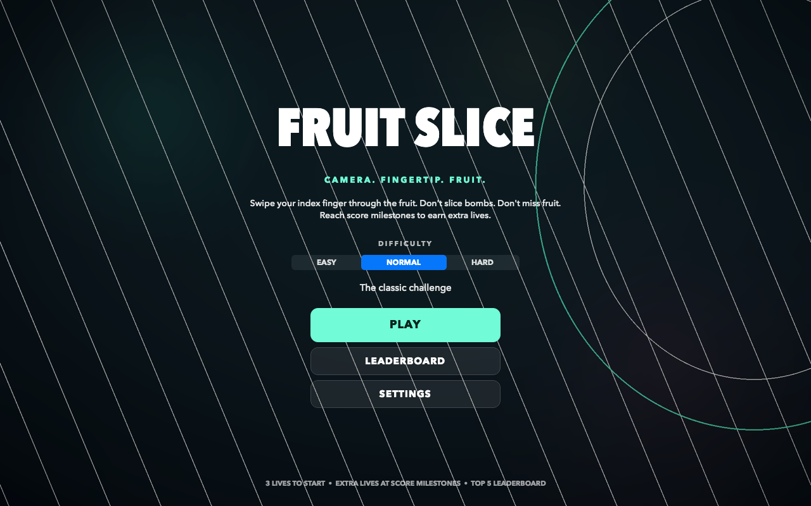
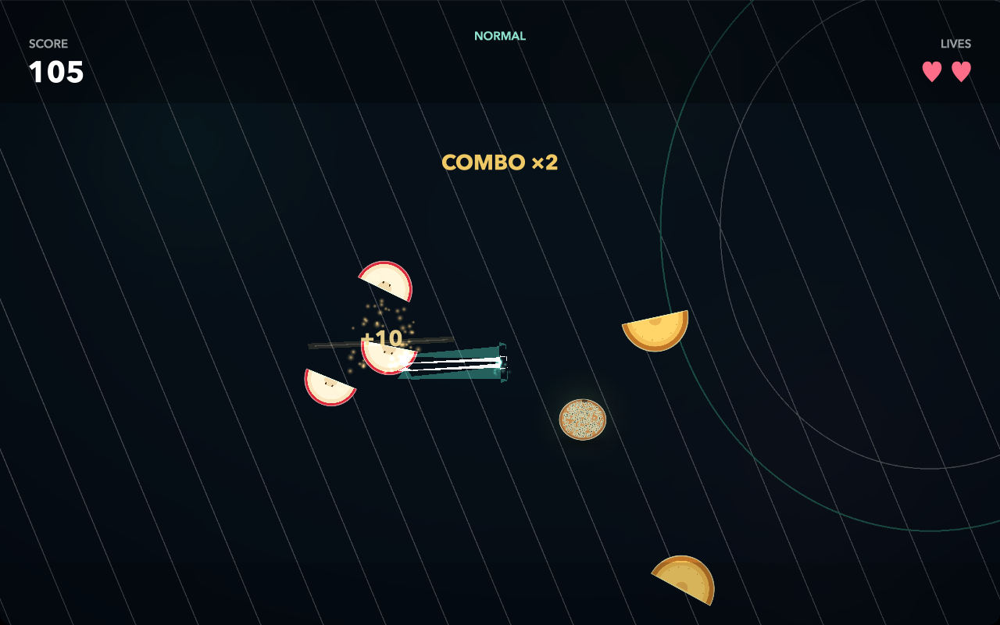
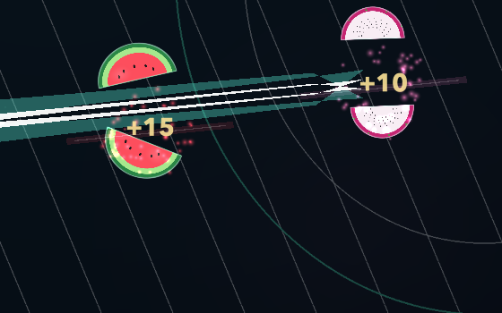
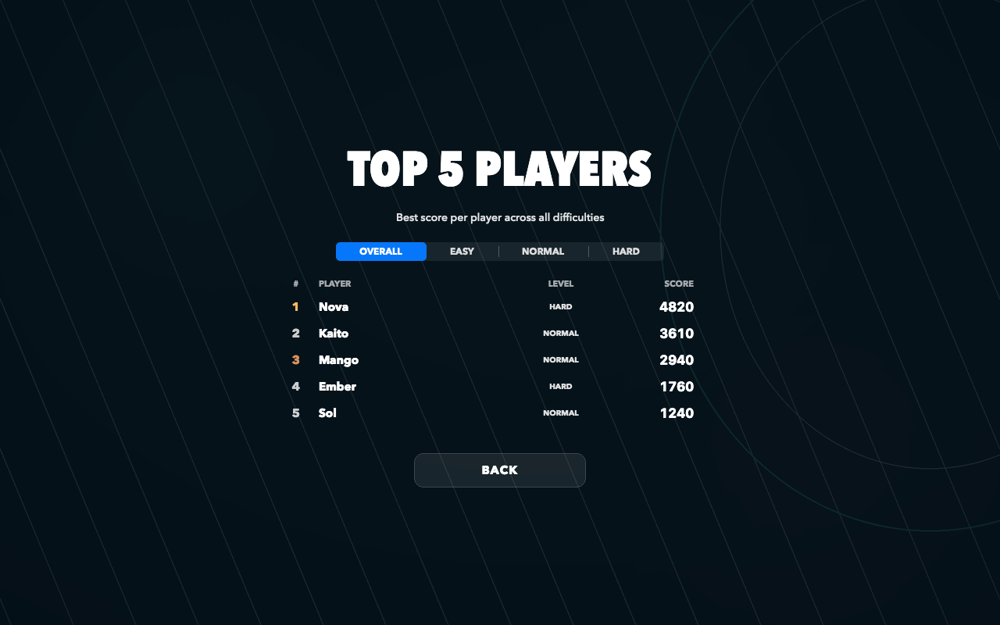
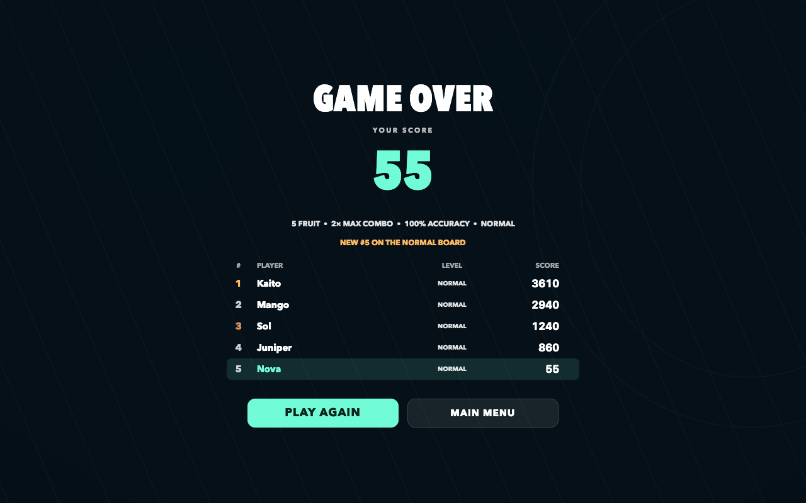
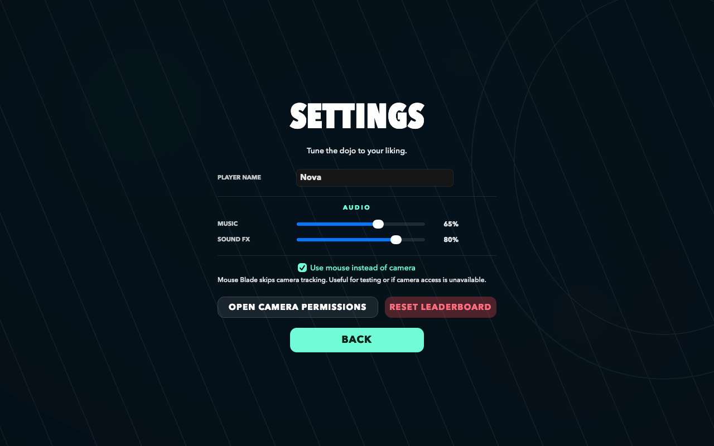

# Fruit Slice

A native macOS Fruit Ninja–style game where your index fingertip is the blade. The front camera feed is mirrored behind the playfield, and Vision hand tracking maps the fingertip to a glowing blade. Slice fruit, avoid bombs, and keep three lives alive.

All artwork, music, sound effects, and the app icon are generated originally by the scripts in `Tools/`. No third-party game assets are used.

## Features

- Live mirrored camera background with GPU/Neural Engine hand-pose tracking.
- One Euro–smoothed fingertip blade with Catmull-Rom trail effects.
- Easy, Normal, and Hard difficulties with different spawn rates, speed, wave sizes, bomb frequency, and extra-life milestones.
- Three starting lives, a five-life cap, and extra lives at score milestones.
- Sliced fruit halves, juice particles, bomb blasts, combo feedback, and a hand-lost recovery state.
- Local top-five leaderboards, overall and per difficulty, with best-score deduplication by player name.
- Original generated art, music, SFX, and `.icns` app icon.
- Mouse Blade fallback for development, accessibility, or when camera access is denied.

## Screenshots

| Main menu | Gameplay |
| --- | --- |
|  |  |

| Split effect | Leaderboard |
| --- | --- |
|  |  |

| Game over | Settings |
| --- | --- |
|  |  |

Screenshots were captured in the mouse-blade fallback using the DEBUG harness, so no camera feed is shown.

## Requirements

- macOS 14 or newer
- Xcode 15 or newer
- [XcodeGen](https://github.com/yonaskolb/XcodeGen) 2.38+ (only needed when regenerating the Xcode project)
- Python 3 with Pillow and NumPy (only needed when regenerating assets)
- `iconutil` and `afconvert`, which ship with macOS, for icon and audio generation

## Build and run

Open `FruitNinja.xcodeproj` in Xcode and run the `FruitNinja` scheme, or build from the command line:

```sh
xcodegen generate   # only after changing project.yml or adding/removing source files
xcodebuild -project FruitNinja.xcodeproj -scheme FruitNinja -configuration Debug build
```

To build into a local directory and launch the signed app bundle:

```sh
xcodebuild -project FruitNinja.xcodeproj -scheme FruitNinja -configuration Debug \
  -derivedDataPath build build
open build/Build/Products/Debug/FruitNinja.app
```

The target uses manual ad-hoc signing with the App Sandbox and camera entitlement. Launch the signed `.app` bundle for camera permission tests. Building with `CODE_SIGNING_ALLOWED=NO` is fine for compile checks, but camera access will not work correctly.

## Camera and input

- On first play, macOS asks for camera access. Grant it in System Settings if needed.
- The camera preview is mirrored so your on-screen motion matches your real motion. Fingertip coordinates use the same mirrored mapping and account for aspect-fill cropping.
- Hand tracking uses `AVCaptureSession` and `VNDetectHumanHandPoseRequest` on Vision's GPU/Neural Engine path, with latest-frame-wins processing, One Euro smoothing, and capped velocity prediction.
- If the hand is lost during play, the game freezes and prompts you to return your hand instead of unfairly deducting a life.
- Enable **Use mouse instead of camera** in Settings to play with the mouse. In mouse mode, move the pointer across the window to slice.

## Gameplay and scoring

- Start with 3 lives.
- Each missed fruit costs 1 life. Each sliced bomb costs 1 life.
- Extra lives are awarded at score thresholds and are capped at 5 total lives.
- Fruit is worth 10 points; slicing several fruit in a short window adds a combo bonus.
- The game-over screen saves the score, shows the top five for the selected difficulty, and offers Play Again or Main Menu.

Difficulty values:

| | Easy | Normal | Hard |
|---|---|---|---|
| Spawn interval | 1.4–2.2 s | 0.9–1.5 s | 0.55–0.95 s |
| Fruit per wave | 1 | 1–2 | 2–3 |
| Speed scale | 0.8× | 1.0× | 1.3× |
| Bomb chance | 5% | 12% | 20% |
| First extra life | 100 pts | 150 pts | 200 pts |
| Extra-life step | +200 pts | +250 pts | +300 pts |
| Lives cap | 5 | 5 | 5 |

## Leaderboard data

Scores are stored as versioned JSON in the app sandbox:

```text
~/Library/Containers/com.sid.fruitslice/Data/Library/Application Support/com.sid.fruitslice/leaderboard.json
```

The leaderboard keeps up to 200 entries, collapses duplicate player names to their best score, and displays the top five overall or per difficulty.

## Tests

```sh
xcodebuild test -project FruitNinja.xcodeproj -scheme FruitNinja \
  -destination 'platform=macOS'
```

The test suite covers slice geometry and speed thresholds, lives and extra-life milestones, difficulty ordering, leaderboard top-five/deduplication/persistence, and One Euro filter behavior.

## Regenerating assets

Install the Python dependencies once:

```sh
python3 -m pip install pillow numpy
```

Then run any of the generators:

```sh
python3 Tools/generate_art.py     # fruit, bombs, halves, background, particles
python3 Tools/generate_icon.py    # AppIcon-1024.png and AppIcon.icns
python3 Tools/generate_music.py   # menu and gameplay music loops
python3 Tools/generate_sfx.py     # slice, bomb, countdown, life, UI sounds
xcodegen generate                 # only if files were added or removed
```

All generators are deterministic and use original procedural designs and synthesis.

## DEBUG screenshot harness

Debug builds include an in-app capture harness for visual verification without external Screen Recording access. Launch the app with `FRUITSLICE_CAPTURE_DIR` set:

```sh
FRUITSLICE_CAPTURE_DIR=captures \
FRUITSLICE_AUTOPLAY=mouse \
  build/Build/Products/Debug/FruitNinja.app/Contents/MacOS/FruitNinja
```

Relative paths are written inside the app sandbox at:

```text
~/Library/Containers/com.sid.fruitslice/Data/tmp/captures
```

Useful environment variables:

- `FRUITSLICE_SCREEN=menu|settings|leaderboard` captures a specific screen.
- `FRUITSLICE_AUTOPLAY=mouse` runs the mouse-mode gameplay and game-over sequence.
- `FRUITSLICE_AUTOSLICE=1` sweeps a synthetic blade across fruit once it reaches mid-screen, exercising slice detection and the split effect without a hand.
- `FRUITSLICE_CAPTURE_SLICES=1` writes a full-window action shot shortly after every slice.
- `FRUITSLICE_FORCE_GAMEOVER=1` ends the auto-play run so the game-over screen can be captured.
- `FRUITSLICE_CAPTURE_DIR` enables the harness; omit it for normal play.

Keep the display awake while capturing (`caffeinate -d -t 60`) so SpriteKit advances and window captures are not blank.

## Project layout

```text
project.yml            XcodeGen project definition
Docs/Screenshots/      README screenshots
FruitNinja/
  App/                 App lifecycle, window, DEBUG capture
  Tracking/            Objective-C camera/Vision/One Euro pipeline
  Game/                SpriteKit scene, fruit, blade, slicing, rules
  UI/                  Menu, settings, leaderboard, game-over overlays
  Services/            Audio, persistence, settings, art loading
  Resources/           Generated art, audio, icon, Info.plist, entitlements
FruitNinjaTests/       Unit tests
Tools/                 Reproducible asset generators
```
